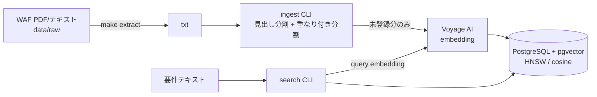

# aws-arch-rag

要件テキストから AWS 構成案（Mermaid）・Well-Architected Framework（WAF）の柱ごとの根拠（引用付き）・懸念点を返す RAG デモ。

ローカルの `docker compose` だけで動かせる RAG デモです。要件を入力すると、AWS 構成図・柱ごとの根拠（引用元へ辿れる）・懸念点がその場で返ってきます。

動くだけでなく、**検索精度を数値（recall@k）で測って改善できること**と、**運用を意識した作り（リクエスト単位のトークン数・レイテンシの構造化ログ）**も重視しています。

## ロードマップ

実装は Phase 1〜3 まで入っています。実際の Voyage / Claude の API キーでの通し動作確認が、まだ済んでいません。

- [x] Phase 1: 取り込みと検索（CLI）
- [x] Phase 2: 生成（Claude・JSON 出力・引用検証）と API（SSE）
- [x] Phase 3: UI（React）と評価 CLI（recall@k）。評価ケースは 15 件
- [ ] 実キーでの通し確認（取り込み → 検索 → 生成 → 画面）
- [ ] recall@k の実測と、チャンク分割などを変えた改善前後の比較
- [ ] デモ動画

## アーキテクチャ（Phase 1）



## 設計上の判断

| 判断 | 理由 |
|---|---|
| 埋め込みは `Embedder` インターフェースの背後（既定: Voyage `voyage-4`） | プロバイダ差し替え・テスト用 fake を容易にするため。次元数は `EMBED_DIM`（既定 1024。`voyage-4` 系は `output_dimension` に 1024 を指定できる）。旧モデルの `voyage-3.5` は無料枠の対象外で、`voyage-4` 系は各アカウント 2億トークンが無料のため切り替えた。モデルを変えるとベクトルの互換性が変わる可能性があるので、変更時は再取り込みする |
| pgvector + HNSW（cosine） | 別の検索基盤を増やさず、メタデータ（pillar）と同じ DB で完結。再構築不要で追加登録できる |
| 再実行しても重複しない（`source + section + content_hash` で一意） | 未登録チャンクだけ埋め込むので、再実行で API 課金が発生しない |
| トークン数は「4文字 ≒ 1トークン」の近似 | 依存を増やさず、チャンクサイズ比較（Phase 3）には十分 |
| 構成案は `output_config.format`（JSON outputs）で受け取る | 目的は「固定形の JSON を返させること」なので、ツール呼び出しではなく JSON outputs が合っている。応答テキストがスキーマ（`internal/generate/schema.go`。pillar は enum、Mermaid の書き方は `description`）に適合する JSON になり、前後に文章が付く・JSON が壊れる失敗が起きない。以前の「文字列から `{...}` を切り出す」処理は不要になった。当初は tool use（`submit_proposal`）を検討したが、現行モデル（既定の `claude-opus-5-5` など）は `tool_choice` の強制指定が 400 になり、`auto` では呼ばれる保証が無いため、JSON outputs を選んだ |
| 生成中の SSE `delta` は進み具合（文字数）だけを流す | tool use の断片は JSON の一部で、そのまま表示しても意味のある文章にならない。フロントは「生成中…（N文字）」を表示し、完成後の `result` で全体を描画する |
| ログは slog（JSON） | チャンク数・埋め込みトークン数・処理時間を機械可読で残す |

## セットアップ

前提: Docker、Go、`poppler`（`brew install poppler`、PDF のテキスト化に使用）、[Voyage AI](https://www.voyageai.com/) の API キー。

```bash
cp .env.example .env          # VOYAGE_API_KEY を設定

# 1. 文書を data/raw/ に置く（下記）。リポジトリには含めていません
# 2. PDF をテキスト化
make extract

# 3. Postgres(pgvector) 起動 + マイグレーション
make up

# 4. 取り込み（再実行しても重複しない）
make ingest

# 5. 検索
make search Q="月間10万PVのECサイト。商品画像のアップロードあり。可用性を重視、予算は抑えたい。"
```

### Docker で一括起動（デモ用）

DB・API・フロントをまとめて起動できます。Go や Node をインストールしなくても動きます（PDF のテキスト化 `make extract` だけはホストの poppler を使います）。

```bash
cp .env.example .env     # VOYAGE_API_KEY / ANTHROPIC_API_KEY を設定（CLAUDE_MODEL は例のまま可）
make extract             # data/raw の PDF を txt に
make demo                # = docker compose up -d --build
make demo-ingest         # data/raw の文書を取り込む（初回のみ。再実行しても重複しない）
open http://localhost:3000
```

| サービス | 役割 | ポート |
|---|---|---|
| `db` | PostgreSQL + pgvector | 5432 |
| `migrate` | マイグレーション（起動時に1回実行して終了） | - |
| `api` | Go の API サーバー | 8081（`API_PORT` で変更可。`make server` でホスト実行する場合は 8080） |
| `web` | フロント（nginx。`/api` を `api` へ中継） | 3000 |

- `.env` に `ANTHROPIC_API_KEY` / `CLAUDE_MODEL` が無いと `api` は起動時にエラーで終了します（`docker compose logs api` で確認）。
- 停止は `make down`。DB のデータは `pgdata` ボリュームに残ります。

### キー無しで画面だけ確認する（モック API）

API キーも DB も使わず、固定のデータを返すモック API で画面を確認できます。実際の検索・生成は行いません。

```bash
make mock    # 別ターミナルで。:8080 でモック API が起動（SSE の流れ方は本物と同じ）
make web     # http://localhost:5173
```

### PDF なしで試す（サンプル文書）

`data/sample/` に、6 本の柱それぞれの短い英文サンプルがあります。これは AWS の文書ではなく、一般的な設計の考え方をこのリポジトリ用にまとめたものです。PDF を用意せずに、取り込みから検索・生成までの流れを試せます（Voyage / Anthropic の API キーは必要です）。

```bash
make demo                  # DB・API・フロントを起動
make demo-ingest-sample    # サンプルを取り込む
open http://localhost:3000
```

実際の評価（recall@k など）は、サンプルではなく AWS 公式の文書で行ってください。

### API サーバー（Phase 2）

`.env` に `ANTHROPIC_API_KEY` と `CLAUDE_MODEL`（例: `claude-opus-5-5`）を設定して起動します。

```bash
make server

# SSE で retrieved → delta → result の順にイベントが流れる
# delta は進み具合のみ: data: {"chars": 48}（構成案の本体は最後の result で届く）
curl -N -X POST localhost:8080/api/propose \
  -H 'Content-Type: application/json' \
  -d '{"requirements":"月間10万PVのECサイト。商品画像のアップロードあり。可用性を重視、予算は抑えたい。"}'

# 引用元のチャンクを取得
curl localhost:8080/api/chunks/12
```

- LLM が返した `chunk_ids` のうち、検索で渡していないものは除外され、ログ（`dropped_chunk_ids`）に残ります。
- リクエストごとに、検索時間・LLM の入出力トークン数・レイテンシ・モデル名を slog（JSON）で出力します。

### 画面（Phase 3）

```bash
make server   # 別ターミナルで API を起動
make web      # http://localhost:5173
```

要件を入力すると、構成図（Mermaid。描画に失敗したらコードを表示）・柱ごとの根拠・懸念点・追加の質問が表示されます。根拠の `[12]` のような引用をクリックすると、元のチャンクが右側に表示されます。

### 評価

`data/eval/cases.yaml` の各ケース（要件と、上位 k 件に入ってほしい**見出し**・柱）に対して recall@k を計算し、Markdown の表で出力します。

```bash
make sections                                # 取り込み済みの見出しを柱ごとに一覧（cases.yaml の期待値を決める材料）
make evaluate LABEL=baseline                 # 検索のみ（Voyage の課金のみ）。k=5
make evaluate LABEL=baseline K=3,5,10        # 複数の k をまとめて出す
make evaluate LABEL=baseline GENERATE=1      # 出力品質も評価（Claude の課金あり。生成には最大の k の検索結果を使う）
```

#### 指標

| 指標 | 意味 |
|---|---|
| **見出し recall@k**（主） | 期待した見出し（`expect.sections`）のうち、上位 k 件の見出しに現れた割合。見出しは大文字小文字を無視した部分一致 |
| 見出し MRR | 期待した見出しのどれかが**最初に現れた順位**の逆数（現れなければ 0）の平均 |
| 柱 recall@k（参考） | 期待した柱（`expect.pillars`）のうち、上位 k 件に現れた割合 |

表は見出し recall を左、柱 recall を右に並べます。`sections` が空のケースは見出し recall・MRR の対象外（表では `-`、起動時に警告）です。

#### なぜ見出し単位にしたか

最初は期待値がほぼ柱単位でした。柱は6本しかないので、上位5件を取ればほとんどのケースでどれかの柱が当たり、recall@k が最初から 1.0 近くに張り付きます。これではチャンクサイズや k を変えても差が見えず、改善を測れません。そこで、「その要件ならこの見出しの内容が必要」という粒度（見出し）に変え、柱は参考指標に下げました。

期待値は**検索結果に合わせて書きません**（出てきた見出しを期待値にすると評価が必ず高く出るため）。人間の判断で決め、`make sections` の一覧から選びます。サンプル文書（`data/sample/`）は見出しが少ないので評価には使いません。

#### baseline（検索のみ）

条件: 埋め込み `voyage-4`（1024 次元）、Well-Architected Framework + Serverless Applications Lens（2050 チャンク、既定のチャンク設定）、評価ケース 15 件（各 3〜4 個の見出しを期待）、k=3,5,10。

| 指標 | k=3 | k=5 | k=10 |
|---|---|---|---|
| **見出し recall@k**（主） | 0.189 | **0.228** | 0.294 |
| 見出し MRR | 0.404 | | |
| 柱 recall@k（参考） | 0.500 | 0.533 | 0.567 |

- 見出し recall@5 は **0.228**。まだ大きく改善の余地があり、チャンクサイズ・k・検索方式を変えた効果を比べられる水準です。
- 柱 recall も、1 ケースで 2 本の柱を期待するため、実測では 0.5〜0.57 でした（「どれかの柱が当たる」割合ではなく、期待した柱のうち当たった割合）。柱は粒度が粗く、ケース間の差も出にくいため、主指標は見出しのままにしています。
- recall が 0 のケース（`ec-site-availability-cost`、`log-analytics-cost`、`data-lake-batch`、`startup-mvp`）は、要件が日本語で文書が英語であること、または期待した見出しと実際の内容のずれが原因として考えられます。原因はまだ調べていません（期待値は検索結果に合わせて変えません）。
- 生成の評価（`GENERATE=1`）は未実施です。

再現: `make evaluate LABEL=baseline-voyage-4 K=3,5,10`（取り込み後）。


`GENERATE=1` では、次も確認します。

- JSON のパース失敗件数（`ErrParse`。応答が空・JSON として不正・必須項目の欠落など）
- JSON がスキーマどおりか（柱名の妥当性、必須項目）
- Mermaid の簡易構文チェック（先頭の宣言・括弧の対応・エッジの有無）。厳密な構文検証ではありません
- 存在しない引用 ID が返されていないか

JSON パース失敗件数の修正前後（`GENERATE=1`、同じ `cases.yaml`）:

| | パース失敗 |
|---|---|
| 修正前（プロンプトで JSON を指示。コミット `e02f33d`、`claude-opus-5-5`、15 ケース） | **0 / 15** |
| 修正後（`output_config.format`、`voyage-4`、k=5、15 ケース） | **0 / 15** |

生成の評価（`make evaluate LABEL=baseline-voyage-4-generate K=5 GENERATE=1`、`CLAUDE_MODEL=claude-opus-5-5`）の結果:

| 指標 | 値 |
|---|---|
| 生成成功 | 15 / 15 |
| JSON パース失敗 | 0 / 15 |
| JSON スキーマ適合 | 15 / 15 |
| Mermaid 簡易構文OK | 15 / 15 |
| 引用IDがすべて実在（除外0件） | 15 / 15 |

修正前（プロンプトだけの方式）でも、この 15 ケースでは JSON パース失敗は 0 件で、スキーマ適合・Mermaid・引用 ID も全件通りました。**この標本では、修正の前後で件数に差は出ていません**（どちらも 0 / 15）。

- 修正前のパーサは前置き文やコードフェンスを許容していたため、「パースできた」ことと「出力が JSON だけだった」ことは同じではありません（フェンス付きの出力がどれだけあったかは数えていません）。
- 15 ケース 1 回ずつの結果で、ばらつきは見ていません。
- `output_config.format` の利点は、この標本で測れた件数の改善ではなく、構造がスキーマで保証される点（モデルや入力が変わっても壊れた JSON が返らない）にあります。

チャンクサイズなどを変えた前後は、`ingest` を `-max-tokens` / `-overlap` 付きで再取り込みし、`LABEL` を変えて同じ表を並べて比較します。

### 取り込む文書

AWS 公式ドキュメントの PDF を `data/raw/` に置きます（著作物のため再配布しません）。

| 文書 | URL |
|---|---|
| Well-Architected Framework（6本の柱すべてを含む） | https://docs.aws.amazon.com/pdfs/wellarchitected/latest/framework/wellarchitected-framework.pdf |
| Serverless Applications Lens | https://docs.aws.amazon.com/pdfs/wellarchitected/latest/serverless-applications-lens/wellarchitected-serverless-applications-lens.pdf |
| SaaS Lens（任意） | https://docs.aws.amazon.com/pdfs/wellarchitected/latest/saas-lens/wellarchitected-saas-lens.pdf |

- 柱は、ファイル名（`reliability-pillar.txt` のように柱名を含む場合）か、フレームワーク文書内の柱の章見出しから判定します。
- 英語版を使い、出力は日本語にします。

### 注意

- `migrations/0001` の `vector(1024)` と `EMBED_DIM` は一致させてください。不一致の場合 ingest は起動時にエラーになります。
- `make test` / `make vet` で単体テストと静的解析を実行できます（DB・API キー不要）。

## ログの例

ingest は完了時に以下の形式で JSON を出力します（数値は書式の例で、実測値ではありません。実測は Phase 1 の動作確認後に差し替えます）。

```json
{"level":"INFO","msg":"ingest done","files":3,"chunks_total":812,"chunks_new":812,"chunks_skipped":0,"embed_tokens":301234,"embed_calls":3,"duration_ms":18423}
```

## ライセンス

MIT
