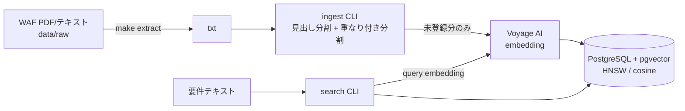

# aws-arch-rag

要件テキストから AWS 構成案（Mermaid）・Well-Architected Framework（WAF）の柱ごとの根拠（引用付き）・懸念点を返す RAG デモ。

ローカルの `docker compose` だけで動かせる RAG デモです。要件を入力すると、AWS 構成図・柱ごとの根拠（引用元へ辿れる）・懸念点がその場で返ってきます。

動くだけでなく、**検索精度を数値（recall@k）で測って改善できること**と、**運用を意識した作り（リクエスト単位のトークン数・レイテンシの構造化ログ）**も重視しています。

## ロードマップ

- [ ] **Phase 1: 取り込みと検索（CLI のみ）** ← 実装済み・動作確認待ち
- [ ] **Phase 2: 生成（Claude・JSON 出力・引用検証）と API（SSE）** ← 実装済み・実 API での動作確認待ち
- [ ] Phase 3: UI（React）・評価（recall@k）・改善前後の比較

## アーキテクチャ（Phase 1）



## 設計上の判断

| 判断 | 理由 |
|---|---|
| 埋め込みは `Embedder` インターフェースの背後（既定: Voyage `voyage-3.5`） | プロバイダ差し替え・テスト用 fake を容易にするため。次元数は `EMBED_DIM` |
| pgvector + HNSW（cosine） | 別の検索基盤を増やさず、メタデータ（pillar）と同じ DB で完結。再構築不要で追加登録できる |
| 再実行しても重複しない（`source + section + content_hash` で一意） | 未登録チャンクだけ埋め込むので、再実行で API 課金が発生しない |
| トークン数は「4文字 ≒ 1トークン」の近似 | 依存を増やさず、チャンクサイズ比較（Phase 3）には十分 |
| ログは slog（JSON） | チャンク数・埋め込みトークン数・処理時間を機械可読で残す |

## セットアップ

前提: Docker、Go、`poppler`（`brew install poppler`、PDF のテキスト化に使用）、[Voyage AI](https://www.voyageai.com/) の API キー。

```bash
cp .env.example .env          # VOYAGE_API_KEY を設定

# 1. 文書を data/raw/ に置く（下記）。リポジトリには含めていません
# 2. PDF をテキスト化
make extract

# 3. Postgres(pgvector) 起動 + マイグレーション
make up

# 4. 取り込み（再実行しても重複しない）
make ingest

# 5. 検索
make search Q="月間10万PVのECサイト。商品画像のアップロードあり。可用性を重視、予算は抑えたい。"
```

### API サーバー（Phase 2）

`.env` に `ANTHROPIC_API_KEY` と `CLAUDE_MODEL`（例: `claude-opus-5-5`）を設定して起動します。

```bash
make server

# SSE で retrieved → delta → result の順にイベントが流れる
curl -N -X POST localhost:8080/api/propose \
  -H 'Content-Type: application/json' \
  -d '{"requirements":"月間10万PVのECサイト。商品画像のアップロードあり。可用性を重視、予算は抑えたい。"}'

# 引用元のチャンクを取得
curl localhost:8080/api/chunks/12
```

- LLM が返した `chunk_ids` のうち、検索で渡していないものは除外され、ログ（`dropped_chunk_ids`）に残ります。
- リクエストごとに、検索時間・LLM の入出力トークン数・レイテンシ・モデル名を slog（JSON）で出力します。

### 取り込む文書

AWS 公式ドキュメントの PDF を `data/raw/` に置きます（著作物のため再配布しません）。

| 文書 | URL |
|---|---|
| Well-Architected Framework（6本の柱すべてを含む） | https://docs.aws.amazon.com/pdfs/wellarchitected/latest/framework/wellarchitected-framework.pdf |
| Serverless Applications Lens | https://docs.aws.amazon.com/pdfs/wellarchitected/latest/serverless-applications-lens/wellarchitected-serverless-applications-lens.pdf |
| SaaS Lens（任意） | https://docs.aws.amazon.com/pdfs/wellarchitected/latest/saas-lens/wellarchitected-saas-lens.pdf |

- 柱は、ファイル名（`reliability-pillar.txt` のように柱名を含む場合）か、フレームワーク文書内の柱の章見出しから判定します。
- 英語版を使い、出力は日本語にします。

### 注意

- `migrations/0001` の `vector(1024)` と `EMBED_DIM` は一致させてください。不一致の場合 ingest は起動時にエラーになります。
- `make test` / `make vet` で単体テストと静的解析を実行できます（DB・API キー不要）。

## ログの例

ingest は完了時に以下の形式で JSON を出力します（数値は書式の例で、実測値ではありません。実測は Phase 1 の動作確認後に差し替えます）。

```json
{"level":"INFO","msg":"ingest done","files":3,"chunks_total":812,"chunks_new":812,"chunks_skipped":0,"embed_tokens":301234,"embed_calls":3,"duration_ms":18423}
```

## ライセンス

MIT
